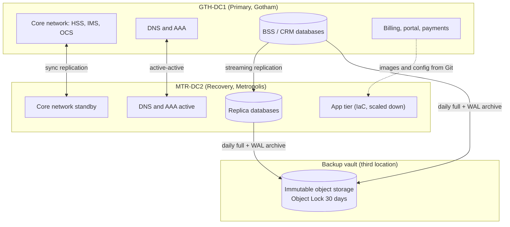
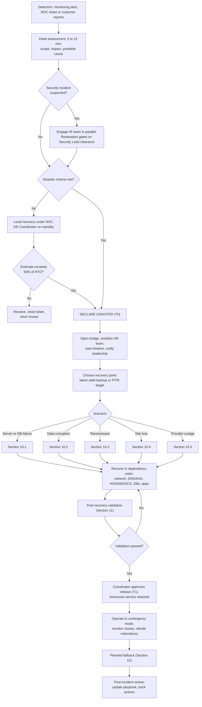

# Arkham Telecom: Disaster Recovery Playbook

> **Fictional scenario.** Arkham Telecom is an imaginary company created for portfolio purposes. All names, systems, IP ranges (RFC 5737 documentation blocks), contacts and metrics are made up. The structure and procedures follow NIST SP 800-34 Rev. 1 and ISO 22301 and can be adapted to real environments.

| Field | Value |
|---|---|
| Document owner | Head of Infrastructure & Resilience |
| Version | 1.0 |
| Classification | Internal (fictional) |
| Last reviewed | 2026-11-03 |
| Review cycle | Every 6 months, and after every incident or exercise |
| Related documents | Incident Response Playbook, Backup Policy, Network Architecture |

---

## Table of Contents

1. [Company context](#1-company-context)
2. [Purpose and scope](#2-purpose-and-scope)
3. [Definitions](#3-definitions)
4. [Roles and responsibilities](#4-roles-and-responsibilities)
5. [Critical systems and recovery objectives](#5-critical-systems-and-recovery-objectives)
6. [Recovery architecture](#6-recovery-architecture)
7. [Activation criteria](#7-activation-criteria)
8. [Response flow](#8-response-flow)
9. [Communication plan](#9-communication-plan)
10. [Scenario procedures](#10-scenario-procedures)
11. [Post-recovery validation](#11-post-recovery-validation)
12. [Failback](#12-failback)
13. [Post-incident review](#13-post-incident-review)
14. [Testing program](#14-testing-program)
15. [Appendices](#15-appendices)

---

## 1. Company context

**Arkham Telecom** is a fictional regional telecommunications operator serving about 1.8 million subscribers across mobile, fixed broadband and enterprise connectivity.

| Item | Detail |
|---|---|
| Services | Mobile voice/SMS/data, FTTH broadband, enterprise VPN and SIP trunking |
| Primary site | **GTH-DC1** (Gotham), Tier III colocation, hosts core network and BSS |
| Recovery site | **MTR-DC2** (Metropolis), warm standby, 300 km from the primary |
| Backup vault | Object storage in a third location with **Object Lock (immutable, 30 days)** |
| Operations | 24x7 NOC and SOC |
| Regulatory exposure | Telecom regulator availability reporting, privacy law (e.g. GDPR / LGPD), emergency-call (112/911) obligations |

**Why DR matters here:** outages directly affect emergency calls, enterprise SLAs and regulatory reporting. Extended downtime also causes churn and SLA penalties.

---

## 2. Purpose and scope

**Purpose:** restore critical services within the agreed RTO and RPO after an event that causes major unavailability or data loss.

**In scope**
- Loss or failure of the primary data center or network core
- Database failure, corruption or mass deletion
- Ransomware or destructive malware (restoration phase only)
- Major cloud, colocation or transport provider outage
- Failed change with major customer impact

**Out of scope**
- Security incident containment, forensics and eradication (see the Incident Response Playbook)
- Radio access network (RAN) site-level outages, handled by NOC field operations
- Non-IT business continuity (facilities, staffing, supply chain)

> **Relationship with Incident Response:** in security incidents, restoration into any environment starts only after the Security Lead confirms that environment is clean. Restoring too early risks reinfection.

---

## 3. Definitions

| Term | Meaning |
|---|---|
| **RTO** | Recovery Time Objective: maximum tolerable downtime |
| **RPO** | Recovery Point Objective: maximum tolerable data loss, measured in time |
| **MTPD** | Maximum Tolerable Period of Disruption |
| **T0** | Time the disaster is formally declared |
| **T1** | Time service is restored and released to users |
| **Measured RTO** | T1 − (time of failure), reported in post-incident review |
| **PITR** | Point-in-Time Recovery |
| **HSS/UDM** | Subscriber database of the mobile core |
| **AAA** | Authentication, Authorization and Accounting (RADIUS) |
| **OCS** | Online Charging System (real-time prepaid balance) |
| **CDR** | Call Detail Record, the raw usage data used for billing |
| **BSS / OSS** | Business / Operations Support Systems |

---

## 4. Roles and responsibilities

| Role | Responsibilities | Primary | Backup |
|---|---|---|---|
| **DR Coordinator** | Declares disaster, owns decisions and priorities, approves release | Head of Infrastructure & Resilience | NOC Director |
| **Network Core Lead** | Core network failover (HSS, IMS, PCRF/OCS, routing, DNS) | Principal Core Network Engineer | Senior Core Engineer |
| **Database Lead** | Database promotion, restores, PITR, integrity checks | Lead DBA | Senior DBA |
| **Platform Lead** | Rebuilds infrastructure via IaC, virtualization, storage | Platform Engineering Manager | SRE Lead |
| **Applications Lead** | BSS, CRM, portal and integrations | BSS Application Manager | CRM Product Owner |
| **Security Lead** | Confirms clean environment, credential rotation, EDR scans | SOC Manager | IR Lead |
| **Communications Lead** | Status updates to leadership, customers, regulator | Head of Corporate Communications | Customer Care Director |
| **Scribe** | Maintains the minute-by-minute timeline | NOC Shift Supervisor | Any NOC analyst |

**Contacts:** stored in `appendix/contacts.md` and also kept **offline** (printed, in the NOC safe and with each lead). All contact addresses use the placeholder domain, e.g. `dr-coordinator@arkham-telecom.example`.

**Out-of-band channels** (used if corporate email and chat are down):
1. Pre-provisioned conference bridge on an external provider
2. Backup messaging group on a separate platform
3. Satellite phone held by the NOC

---

## 5. Critical systems and recovery objectives

Result of the Business Impact Analysis (BIA).

| Priority | System | Function | RTO | RPO | Strategy | Protection |
|---|---|---|---|---|---|---|
| **P1** | DNS + AAA/RADIUS | Name resolution, subscriber authentication | 15 min | 0 | Active-active across sites | Synchronous config, multi-site |
| **P1** | HSS/UDM | Subscriber identity and profile | 15 min | 0 | Hot standby, geo-redundant | Synchronous replication |
| **P1** | IMS / Voice core (incl. emergency calls) | Voice, SMS, 112/911 routing | 30 min | 0 | Hot standby | Geo-redundant cluster |
| **P1** | PCRF / OCS | Policy and real-time charging | 30 min | 1 min | Warm standby | Async replication, lag alert at 30 s |
| **P2** | Billing and CDR mediation | Rating, invoicing | 4 h | 15 min | Warm site + restore | Streaming replication + WAL archive |
| **P2** | Customer portal and mobile app | Self-service, top-ups | 4 h | 15 min | Rebuild via IaC | Container images + DB replica |
| **P2** | Payment gateway integration | Payments, top-ups | 4 h | 15 min | Failover endpoint | Config in Git, secrets in vault |
| **P2** | CRM and ticketing | Customer care | 8 h | 1 h | Restore from backup | Hourly snapshots |
| **P3** | Data warehouse / analytics | Reporting | 48 h | 24 h | Restore from backup | Nightly backup |
| **P3** | ERP / internal tools | Back office | 48 h | 24 h | Restore from backup | Nightly backup |

### Recovery order (dependencies first)


### Backup policy (3-2-1-1-0)

| Rule | Implementation |
|---|---|
| 3 copies | Production + MTR-DC2 replica + vault |
| 2 media types | Block storage + object storage |
| 1 off-site | Vault in a third location |
| 1 immutable | Object Lock, 30 days, separate credentials and account |
| 0 errors | Automated weekly restore test with integrity validation |

---

## 6. Recovery architecture



| Component | Tooling (example) |
|---|---|
| Infrastructure as Code | Terraform + Ansible, stored in Git |
| Database backup/PITR | pgBackRest (PostgreSQL), streaming replication |
| File/config backup | restic to immutable object storage |
| Monitoring | Prometheus + Grafana, alert on replication lag and missed backups |
| Secrets | Vault with replicated cluster; break-glass credentials in sealed offline envelope |

---

## 7. Activation criteria

### Severity levels

| Level | Description | Example | Action |
|---|---|---|---|
| **S1: Degradation** | Reduced performance, no outage | One cluster node down | Normal NOC handling |
| **S2: Partial outage** | A critical system down, locally recoverable | Billing DB server failure | Local recovery, DR Coordinator on alert |
| **S3: Disaster** | Loss of P1 services or the primary site, RTO at risk | Site loss, ransomware, mass data corruption | **Activate this playbook** |

### Declare a disaster when any of the following is true

- [ ] A P1 system is unavailable and the local repair estimate exceeds **50% of its RTO**
- [ ] GTH-DC1 is unreachable or non-operational
- [ ] Data loss or corruption requires restoration from backup
- [ ] Ransomware or destructive malware is confirmed on production systems
- [ ] Emergency-call routing (112/911) is impaired and cannot be fixed within 10 minutes

**Authority:** the DR Coordinator declares. If unreachable for 10 minutes, the NOC Director may declare; failing that, any Lead.

> **When in doubt, declare.** The cost of an unnecessary activation is far lower than the cost of a late one.

---

## 8. Response flow



### Phase checklists

**Phase 1: Detect and assess (0 to 15 min)**
- [ ] Confirm the event is real (not a monitoring false positive or planned maintenance)
- [ ] Identify affected systems, subscribers and regions
- [ ] Determine probable cause: failure, attack or human error
- [ ] Start the timeline (Scribe)
- [ ] Estimate local repair time

**Phase 2: Declare and mobilize (15 to 30 min)**
- [ ] DR Coordinator declares and records **T0**
- [ ] Open out-of-band bridge
- [ ] Page all Leads per the contact list
- [ ] Select the recovery point
- [ ] First leadership notification

**Phase 3: Recover**
- [ ] Execute the scenario procedure (Section 10)
- [ ] Follow dependency order (Section 5)
- [ ] Reassess progress against RTO every 30 minutes; escalate if at risk

**Phase 4: Validate and release**
- [ ] Complete the validation checklist (Section 11)
- [ ] Coordinator approves release, record **T1**
- [ ] Announce restoration

**Phase 5: Stabilize and fail back**
- [ ] Monitor intensively for 48 hours
- [ ] Rebuild redundancy (standby, replicas, backups)
- [ ] Plan failback

---

## 9. Communication plan

| Trigger | Audience | Channel | Owner |
|---|---|---|---|
| Disaster declared | DR team, executive team | Bridge, SMS | DR Coordinator |
| Every 60 min during incident | Executive team | Out-of-band messaging | Communications Lead |
| Subscriber impact confirmed | Customers | Status page, SMS, social media | Communications Lead |
| Enterprise SLA at risk | Enterprise account managers and clients | Email, phone | Customer Care Director |
| Emergency-call impact | Telecom regulator, emergency services coordination | Official channel per license obligations | Legal / Regulatory Affairs |
| Personal data affected | DPO, regulator, data subjects (as required) | Per privacy policy | DPO / Legal |
| Service restored | All of the above | Same channels | Communications Lead |

### Status update template

```
[Arkham Telecom] Service Update #N | HH:MM UTC
Status: Investigating / Recovering / Restored
Impact: [services and regions affected]
Actions in progress: [short summary]
Next update: HH:MM UTC
```

> Share confirmed facts only. Do not speculate on root cause or promise restoration times that cannot be guaranteed.

---

## 10. Scenario procedures

### 10.1 Server or database failure

**Symptoms:** service down, connection errors, host unreachable.

1. Rule out network issues by testing from a second vantage point.
2. Check replica/standby health and replication lag.
3. **With a healthy replica:** promote it and repoint applications.
   ```bash
   # PostgreSQL standby promotion
   sudo -u postgres pg_ctl promote -D /var/lib/postgresql/data
   ```
4. **Without a replica:** provision a new node through IaC and restore the latest backup plus WAL.
   ```bash
   terraform -chdir=infra/mtr-dc2 apply -target=module.billing_db
   pgbackrest --stanza=billing restore
   ```
5. Update DNS / connection strings / load balancer.
6. Validate (Section 11).
7. Rebuild the replica to restore redundancy.

### 10.2 Data corruption or mass deletion (PITR)

**Symptoms:** incorrect balances, missing subscriber records, failed bulk update or script.

1. **Stop writes** to the affected database to avoid replicating the damage.
2. Identify the exact moment before the event using application and audit logs.
3. Restore to an **isolated environment** at that point in time. Do not overwrite production.
   ```bash
   pgbackrest --stanza=billing --type=time \
     --target="2026-03-14 02:14:59+00" --target-action=promote restore
   ```
4. Validate restored data (record counts, balance checksums, CDR continuity).
5. Decide: replace production, or extract and re-apply only the affected data.
6. For prepaid balances, reconcile against the OCS transaction log to recover transactions between the recovery point and the failure.
7. Document the actual data-loss window (measured RPO).

### 10.3 Ransomware

> **Prerequisite:** the Security Lead confirms containment. Never restore into a network that may still be compromised.

1. **Isolate** affected systems from the network. Do not power off without IR guidance, to preserve volatile evidence.
2. **Preserve evidence** (disk and memory images) per the IR Playbook.
3. **Assess backups:**
   - [ ] Was the backup repository reachable by the attacker?
   - [ ] Is the immutable vault copy intact?
   - [ ] What is the last restore point **before** initial compromise? (consider attacker dwell time)
4. Rebuild in a **clean environment** from IaC and golden images. Do not reuse compromised hosts.
5. **Rotate all credentials** before reconnecting: privileged accounts, service accounts, API keys, certificates, database passwords, RADIUS shared secrets.
6. Restore data in priority order (Section 5).
7. Scan restored data with EDR/antimalware before release.
8. Monitor for reinfection indicators for at least 30 days.
9. Evaluate legal notification duties (privacy law, telecom regulator).

### 10.4 Total loss of the primary site (GTH-DC1)

**Symptoms:** data center unreachable, power or cooling failure, physical event, extended carrier outage.

1. Confirm scope and estimated time to restore with the colocation provider.
2. Declare disaster if the estimate exceeds the RTO of any P1 system.
3. Activate **MTR-DC2**:
   - [ ] Network: BGP announcements, VPN tunnels, firewall rules
   - [ ] DNS: confirm secondary authoritative servers answering; adjust records if needed
   - [ ] AAA/RADIUS: verify MTR-DC2 nodes handling all authentication
   - [ ] HSS/UDM and IMS: confirm standby is primary; verify **emergency-call routing first**
   - [ ] OCS/PCRF: promote replica, accept up to 1 min of lag-related data loss
   - [ ] Databases: promote BSS and CRM replicas
   - [ ] Applications: scale up from IaC (`terraform apply`, Ansible playbooks)
   - [ ] Secrets and certificates: verify vault availability and certificate validity
4. Validate (Section 11).
5. Route customer traffic to MTR-DC2.
6. Communicate capacity limitations and any data within the RPO window that may be lost.

### 10.5 Cloud, colocation or transport provider outage

1. Check the provider status page and open a priority ticket.
2. Evaluate options: alternate zone/region, alternate carrier, degraded mode.
3. Activate failover (secondary carrier, secondary region) where available.
4. Log SLA impact for later contract review.
5. If no alternative exists, communicate and provide regular updates.

---

## 11. Post-recovery validation

No system returns to production without validation.

### Technical
- [ ] Services started and health checks passing
- [ ] Database integrity checks clean; record counts match expectations
- [ ] **Latest restored data timestamp** recorded and compared with RPO
- [ ] **Test calls** (including emergency number), SMS and data sessions succeed
- [ ] RADIUS authentication succeeding at expected rate
- [ ] Real-time charging working (test top-up and usage deduction)
- [ ] Billing and CDR mediation processing without backlog errors
- [ ] Integrations working (payment gateway, SMS gateway, interconnect partners)
- [ ] Certificates valid, DNS resolving correctly
- [ ] Monitoring, logging and SIEM ingestion active
- [ ] Backups configured and running in the recovery environment

### Functional
- [ ] NOC executes synthetic transactions for critical customer journeys
- [ ] Customer care confirms CRM and ticketing usability
- [ ] No abnormal error rates in logs

### Sign-off

| Item | Owner | Time | Approved |
|---|---|---|---|
| Technical validation | Network Core Lead / Database Lead | | ☐ |
| Functional validation | NOC Director | | ☐ |
| Security clearance (if attack) | Security Lead | | ☐ |
| Release to production | DR Coordinator | | ☐ |

---

## 12. Failback

Failback is a **planned change, not an emergency**. Schedule it in a low-traffic window (e.g. 02:00 to 05:00 local).

1. Confirm GTH-DC1 is repaired or rebuilt, stable and (if applicable) cleared by Security.
2. Reverse replication: sync data from MTR-DC2 back to GTH-DC1.
3. Announce the maintenance window to stakeholders and regulators where required.
4. Freeze writes, perform the final sync and verify consistency.
5. Redirect traffic back to GTH-DC1.
6. Execute the validation checklist (Section 11).
7. Re-establish MTR-DC2 as standby and normal replication.
8. Keep MTR-DC2 intact for 7 days as a rollback path.

---

## 13. Post-incident review

Held within 5 business days, **blameless** format.

### Metrics

| Metric | Target | Actual | Variance |
|---|---|---|---|
| Measured RTO (per system) | per Section 5 | | |
| Measured RPO (per system) | per Section 5 | | |
| Time to declare disaster | ≤ 30 min | | |
| Time to first customer communication | ≤ 60 min | | |

### Guiding questions
- What happened and what was the root cause?
- Was the playbook followed? Where was it unclear, wrong or outdated?
- Were RTO and RPO met? If not, why?
- Did backups and replicas behave as expected?
- Was communication timely and accurate?
- What changes will prevent or reduce impact next time?

### Action tracker

| ID | Action | Owner | Due | Status |
|---|---|---|---|---|
| | | | | |

---

## 14. Testing program

An untested plan is a hypothesis.

| Test | Frequency | Description |
|---|---|---|
| Document review | Quarterly | Contacts, inventory and procedures current |
| Automated restore test | Weekly | Pipeline restores a sample backup and validates integrity |
| Tabletop exercise | Semi-annual | Walk through a scenario with decision-makers |
| Partial failover | Semi-annual | Fail over a single P2 system to MTR-DC2 |
| Full DR exercise (game day) | Annual | Simulated loss of GTH-DC1, measuring RTO/RPO |

### Exercise log (fictional examples)

| ID | Date | Type | Scenario | Target RTO | Measured RTO | Target RPO | Measured RPO | Key findings |
|---|---|---|---|---|---|---|---|---|
| GD-2026-01 | 2026-02-12 | Tabletop | Ransomware on billing | n/a | n/a | n/a | n/a | Security clearance step missing from runbook; added |
| GD-2026-02 | 2026-04-23 | Partial failover | Billing DB loss | 4 h | **2 h 35 min** | 15 min | **9 min** | PITR target time was found slowly; added audit-log query to runbook |
| GD-2026-03 | 2026-06-18 | Automated restore | Weekly restore job | n/a | 41 min | n/a | n/a | One restore failed on expired vault credential; added expiry alert |
| GD-2026-04 | 2026-10-08 | Full game day | Loss of GTH-DC1 | 30 min (P1) / 4 h (P2) | **47 min (P1)** / 3 h 20 min (P2) | 1 min (OCS) | **2 min** | **P1 RTO missed:** OCS promotion manual and slow. Remediation: automate promotion. Re-test scheduled |

> The missed target in GD-2026-04 is deliberate. Documenting failures and fixes demonstrates the value of testing.

### Triggers for extraordinary review
- Major architecture or vendor change
- New critical system
- Real incident or failed exercise
- Key personnel change
- Regulatory change

---

## 15. Appendices

| ID | Document | Location |
|---|---|---|
| A | Architecture diagrams (primary and recovery) | `appendix/architecture.md` |
| B | Emergency contacts and vendor escalation paths | `appendix/contacts.md` |
| C | System-level technical runbooks | `runbooks/` |
| D | Break-glass credential process | Sealed offline envelope, NOC safe |
| E | Vendor contracts and SLAs | `appendix/vendors.md` |
| F | Game day report template | `appendix/gameday-template.md` |
| G | Incident Response Playbook | `../incident-response/README.md` |

### References
- NIST SP 800-34 Rev. 1, *Contingency Planning Guide for Federal Information Systems*
- NIST SP 800-61 Rev. 2, *Computer Security Incident Handling Guide*
- ISO 22301, *Security and resilience: Business continuity management systems*
- ISO/IEC 27031, *Guidelines for ICT readiness for business continuity*

---

## Version history

| Version | Date | Author | Changes |
|---|---|---|---|
| 1.0 | 2026-11-03 | Infrastructure & Resilience | Initial release |

## License

MIT
